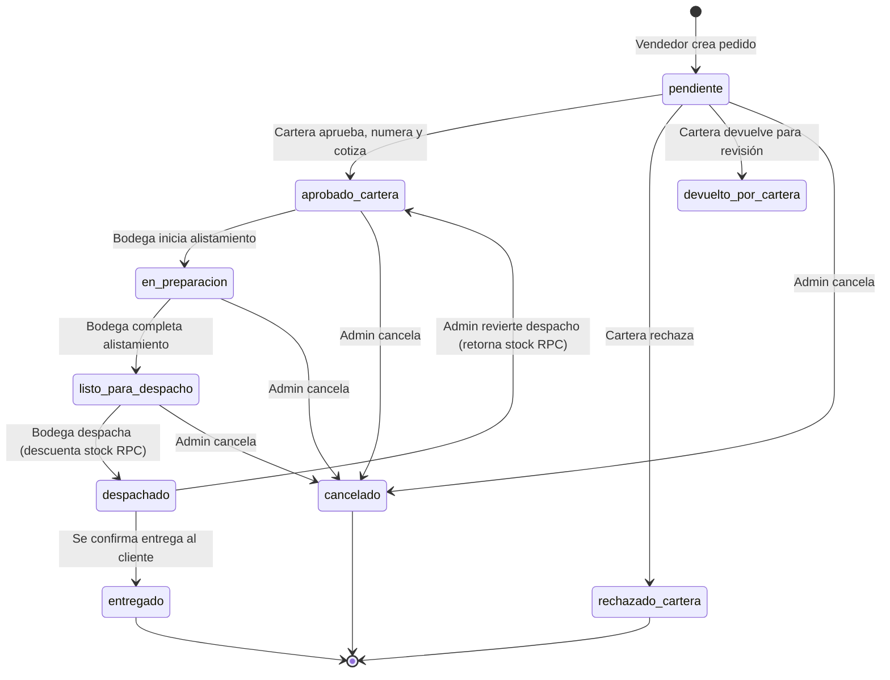

# Contexto Integral del Proyecto: Mobulaa

Documentación técnica y funcional del proyecto para traspaso de conocimiento. Este documento describe la arquitectura, rutas, modelo de datos, lógica de negocio, funciones transaccionales e integraciones basándose exclusivamente en el código fuente actual.

---

## 1. Estructura

Árbol de directorios y archivos de las carpetas `app/`, `components/`, `lib/`, `supabase/`, `types/` y la raíz del proyecto (excluyendo `node_modules`, `.next` y `.git`):

```text
Mobulaaa/
├── .env.local
├── .gitignore
├── AGENTS.md
├── CLAUDE.md
├── PROYECTO_CONTEXTO.md
├── README.md
├── eslint.config.mjs
├── next-env.d.ts
├── next.config.ts
├── package.json
├── package-lock.json
├── postcss.config.mjs
├── proxy.ts
├── tsconfig.json
├── tsconfig.tsbuildinfo
├── public/
│   ├── Logoo.png
│   ├── file.svg
│   ├── globe.svg
│   ├── logo-mobulaa-blanco.png
│   ├── logo-mobulaa.png
│   ├── next.svg
│   ├── vercel.svg
│   └── window.svg
├── app/
│   ├── favicon.ico
│   ├── globals.css
│   ├── layout.tsx
│   ├── page.tsx
│   ├── (auth)/
│   │   ├── layout.tsx
│   │   ├── cambiar-password/
│   │   │   └── page.tsx
│   │   ├── login/
│   │   │   └── page.tsx
│   │   ├── olvide-password/
│   │   │   └── page.tsx
│   │   └── registro/
│   │       └── page.tsx
│   ├── auth/
│   │   └── callback/
│   │       └── route.ts
│   ├── (dashboard)/
│   │   ├── layout.tsx
│   │   ├── admin/
│   │   │   ├── bodegas/
│   │   │   │   └── page.tsx
│   │   │   ├── configuracion/
│   │   │   │   └── page.tsx
│   │   │   ├── cortes/
│   │   │   │   ├── [id]/
│   │   │   │   │   └── page.tsx
│   │   │   │   └── page.tsx
│   │   │   ├── entradas/
│   │   │   │   └── page.tsx
│   │   │   ├── estadisticas/
│   │   │   │   └── page.tsx
│   │   │   ├── inventario/
│   │   │   │   └── page.tsx
│   │   │   ├── logs/
│   │   │   │   └── page.tsx
│   │   │   ├── movimientos/
│   │   │   │   └── page.tsx
│   │   │   ├── pedidos/
│   │   │   │   └── page.tsx
│   │   │   ├── productos/
│   │   │   │   ├── [id]/
│   │   │   │   │   └── editar/
│   │   │   │   │       └── page.tsx
│   │   │   │   └── page.tsx
│   │   │   ├── reportes/
│   │   │   │   └── page.tsx
│   │   │   ├── subir-inventario/
│   │   │   │   └── page.tsx
│   │   │   ├── usuarios/
│   │   │   │   └── page.tsx
│   │   │   └── page.tsx
│   │   ├── bodeguero/
│   │   │   ├── pedidos/
│   │   │   │   └── page.tsx
│   │   │   └── page.tsx
│   │   ├── cartera/
│   │   │   └── page.tsx
│   │   ├── pedidos/
│   │   │   └── [id]/
│   │   │       └── cotizacion/
│   │   │           └── page.tsx
│   │   └── vendedor/
│   │       ├── catalogo/
│   │       │   └── page.tsx
│   │       ├── mis-pedidos/
│   │       │   └── page.tsx
│   │       └── page.tsx
│   └── api/
│       ├── admin/
│       │   └── crear-usuario/
│       │       └── route.ts
│       ├── auth/
│       │   └── google/
│       │       ├── callback/
│       │       │   └── route.ts
│       │       └── route.ts
│       ├── cortes/
│       │   ├── aplicar/
│       │   │   └── route.ts
│       │   ├── crear/
│       │   │   └── route.ts
│       │   └── revertir/
│       │       └── route.ts
│       ├── cotizacion/
│       │   ├── generar/
│       │   │   └── route.ts
│       │   └── preview/
│       │       └── route.ts
│       └── subir-inventario/
│           └── route.ts   (Deshabilitada con 410 Gone)
├── components/
│   ├── ProvidersWithKey.tsx
│   ├── cotizaciones/
│   │   ├── CotizacionBadge.tsx
│   │   ├── CotizacionDocument.tsx
│   │   └── CotizacionPreview.tsx
│   ├── dashboard/
│   │   ├── DashboardContent.tsx
│   │   └── SessionTimeoutModal.tsx
│   └── pedidos/
│       ├── ClienteBuscadorModal.tsx
│       ├── ClienteCard.tsx
│       ├── ClienteNuevoForm.tsx
│       ├── ClienteSelector.tsx
│       ├── FiltrosModal.tsx
│       ├── HistorialClienteModal.tsx
│       ├── PedidoCardCompacta.tsx
│       ├── PedidoDetalleModal.tsx
│       ├── PedidoTimeline.tsx
│       ├── ProductoBuscadorModal.tsx
│       └── ProductoSelector.tsx
├── lib/
│   ├── context/
│   │   ├── NotificacionesContext.tsx
│   │   ├── ThemeContext.tsx
│   │   └── TiendaContext.tsx
│   ├── google/
│   │   ├── drive.ts
│   │   └── oauth.ts
│   ├── hooks/
│   │   ├── useBuscarCliente.ts
│   │   ├── useBuscarProducto.ts
│   │   ├── useDebounce.ts
│   │   └── useInactivityLogout.ts
│   ├── supabase/
│   │   ├── client.ts
│   │   └── server.ts
│   └── utils/
│       ├── cortes.ts
│       ├── cotizacion.ts
│       ├── dataExcel.ts
│       ├── formatNumbers.ts
│       └── historial.ts
├── supabase/
│   └── migrations/
│       └── 20261009_inventario_por_bodega.sql
└── types/
    ├── clientes.ts
    └── index.ts
```

---

## 2. Rutas y Pantallas

Lista de archivos en `app/` con su función y rol autorizado:

| Archivo | Ruta | Descripción | Rol que puede entrar |
|---|---|---|---|
| `app/layout.tsx` | N/A (Root Layout) | Layout raíz; configura viewport, metadata, Google Font Inter y script anti-flash de tema claro/oscuro. | Público / Todos |
| `app/page.tsx` | `/` | Redirección automática hacia `/login`. | Público |
| `app/(auth)/layout.tsx` | N/A (Auth Layout) | Envoltorio para pantallas de autenticación con fondo y márgenes seguros para móvil. | Público |
| `app/(auth)/login/page.tsx` | `/login` | Formulario de autenticación por email y contraseña; detecta razones de redirección (`timeout`, `inactivo`), valida `requiere_cambio_password` y redirige según rol. | Público (no autenticados) |
| `app/(auth)/registro/page.tsx` | `/registro` | Formulario de registro público; crea usuario en Supabase Auth y registro en tabla `usuarios` con rol `vendedor`. | Público (no autenticados) |
| `app/(auth)/olvide-password/page.tsx` | `/olvide-password` | Formulario de recuperación de contraseña; envía correo de reset con enlace hacia `/auth/callback`. | Público (no autenticados) |
| `app/(auth)/cambiar-password/page.tsx` | `/cambiar-password` | Formulario de cambio de contraseña forzoso (primer login) o recuperación; actualiza contraseña en Auth y `requiere_cambio_password = false`. | Autenticado / En recuperación |
| `app/auth/callback/route.ts` | `/auth/callback` (GET) | Intercambia el código OTP de Supabase por una sesión activa de servidor y redirige a `/cambiar-password?recovery=1`. | Público |
| `app/(dashboard)/layout.tsx` | N/A (Dashboard Layout) | Layout protegido del panel; valida sesión, estado `activo`, verifica bodegas asignadas en `usuario_bodegas` para no-admins, y monta `ProvidersWithKey` (Tema + Tienda), `NotificacionesProvider` y `DashboardContent`. | Autenticados (con bodega asignada o admin) |
| `app/(dashboard)/admin/page.tsx` | `/admin` | Panel de control de administrador con KPIs globales del sistema y métricas específicas de la tienda activa. | `admin` |
| `app/(dashboard)/admin/bodegas/page.tsx` | `/admin/bodegas` | Gestión CRUD de tiendas y bodegas físicas (crear, editar, borrado lógico). | `admin` |
| `app/(dashboard)/admin/configuracion/page.tsx` | `/admin/configuracion` | Configuración de integraciones externas (conexión Google OAuth y estado de Google Drive para cotizaciones). | `admin` |
| `app/(dashboard)/admin/cortes/page.tsx` | `/admin/cortes` | Listado histórico de conteos/cortes de inventario por bodega, con totales de nuevos, modificados, ausentes y estados (aplicado, revertido). | `admin` |
| `app/(dashboard)/admin/cortes/[id]/page.tsx` | `/admin/cortes/[id]` | Vista detallada de un corte con desglose por producto, diferencias de stock/precio, botón para aplicar al inventario (`rpc aplicar_corte`) o revertir. | `admin` |
| `app/(dashboard)/admin/entradas/page.tsx` | `/admin/entradas` | Formulario de entrada de mercancía mediante función transaccional `rpc('ajustar_stock')`. | `admin` |
| `app/(dashboard)/admin/estadisticas/page.tsx` | `/admin/estadisticas` | Tablero de analítica visual con gráficos Recharts (stock por categoría, movimientos temporales por tipo y KPIs). | `admin` |
| `app/(dashboard)/admin/inventario/page.tsx` | `/admin/inventario` | Consulta general de inventario por bodega con filtros por categorías dinámicas y buscador. | `admin` |
| `app/(dashboard)/admin/logs/page.tsx` | `/admin/logs` | Auditoría del sistema (`logs_sistema`), con filtros por tabla, historial de cambios y restauración de productos eliminados solicitando contraseña de admin. | `admin` |
| `app/(dashboard)/admin/movimientos/page.tsx` | `/admin/movimientos` | Historial de movimientos de inventario (`stock_anterior`, `stock_nuevo`, entradas, salidas, traslados, ajustes) por periodo. | `admin` |
| `app/(dashboard)/admin/pedidos/page.tsx` | `/admin/pedidos` | Vista integral de pedidos con filtros avanzados (`FiltrosModal`), agrupación mensual, modal de detalle con timeline, edición, cancelación y rollback. | `admin` |
| `app/(dashboard)/admin/productos/page.tsx` | `/admin/productos` | Catálogo de productos; muestra stock por bodega, estados de congelado, filtros y creación rápida. | `admin` |
| `app/(dashboard)/admin/productos/[id]/editar/page.tsx` | `/admin/productos/[id]/editar` | Edición completa de producto: nombres, referencias Excel, precios (mayorista, TAT, unidad), congelado manual y límite de congelado. | `admin` |
| `app/(dashboard)/admin/reportes/page.tsx` | `/admin/reportes` | Reportes filtrables por fecha: total facturado, movimientos por tipo, vendedores top y productos más pedidos. | `admin` |
| `app/(dashboard)/admin/subir-inventario/page.tsx` | `/admin/subir-inventario` | Formulario para cargar archivo Excel de inventario, genera corte previo comparativo antes de aplicarlo. | `admin` |
| `app/(dashboard)/admin/usuarios/page.tsx` | `/admin/usuarios` | Administración de usuarios: creación vía `/api/admin/crear-usuario`, edición, asignación múltiple de bodegas (`usuario_bodegas`), reseteo y desactivación. | `admin` |
| `app/(dashboard)/bodeguero/page.tsx` | `/bodeguero` | Panel inicial de bodeguero con tarjetas de pedidos pendientes y métricas de la bodega activa. | `bodeguero` (y `admin`) |
| `app/(dashboard)/bodeguero/pedidos/page.tsx` | `/bodeguero/pedidos` | Gestión operativa de pedidos listos para bodega (`aprobado_cartera`, `en_preparacion`, `listo_para_despacho`, `despachado`). Ejecuta alistamiento, despacho con `rpc('despachar_pedido')` y entrega. | `bodeguero` (y `admin`) |
| `app/(dashboard)/cartera/page.tsx` | `/cartera` | Gestión financiera de pedidos: toma pedidos en estado `pendiente`, calcula descuentos comerciales, aprueba generando número de cotización secuencial y factura, dispara PDF a Drive, o devuelve/rechaza. | `cartera` (y `admin`) |
| `app/(dashboard)/pedidos/[id]/cotizacion/page.tsx` | `/pedidos/[id]/cotizacion` | Vista completa / previsualización de cotización formal de un pedido. | Autenticados |
| `app/(dashboard)/vendedor/page.tsx` | `/vendedor` | Pantalla de vendedor con tarjetas de pedidos, cotizaciones, y modal de creación de pedidos en 2 pasos con stock congelado unificado. | `vendedor` |
| `app/(dashboard)/vendedor/catalogo/page.tsx` | `/vendedor/catalogo` | Catálogo visual de productos con existencias disponibles en la bodega seleccionada para el vendedor. | `vendedor` |
| `app/(dashboard)/vendedor/mis-pedidos/page.tsx` | `/vendedor/mis-pedidos` | Vista completa optimizada para móvil con listado compacto (`PedidoCardCompacta`), filtros, modal de cliente y creación de pedidos. | `vendedor` (y `admin`) |
| `app/api/admin/crear-usuario/route.ts` | `/api/admin/crear-usuario` (POST) | API Route que usa la Service Role Key para crear el usuario en Supabase Auth, insertarlo en `usuarios` (`requiere_cambio_password: true`) y asignarle múltiples bodegas en `usuario_bodegas`. | `admin` autenticado y activo |
| `app/api/auth/google/route.ts` | `/api/auth/google` (GET) | Inicia el flujo OAuth 2.0 con Google solicitando scopes de Google Drive. | `admin` |
| `app/api/auth/google/callback/route.ts` | `/api/auth/google/callback` (GET) | Recibe el código de autorización de Google, intercambia por `refresh_token` y guarda las credenciales en `google_oauth_tokens`. | `admin` |
| `app/api/cortes/crear/route.ts` | `/api/cortes/crear` (POST) | Parsea el archivo Excel, compara contra inventario actual/último corte, y crea registros en `cortes` y `cortes_detalle`. | `admin` |
| `app/api/cortes/aplicar/route.ts` | `/api/cortes/aplicar` (POST) | Ejecuta la función transaccional PostgreSQL `rpc('aplicar_corte')` para volcar los cambios del corte al inventario. | `admin` |
| `app/api/cortes/revertir/route.ts` | `/api/cortes/revertir` (POST) | Marca un corte sin aplicar como revertido con auditoría de motivo y usuario. | `admin` |
| `app/api/cotizacion/generar/route.ts` | `/api/cotizacion/generar` (POST) | Genera el PDF con `@react-pdf/renderer`, crea la jerarquía de carpetas Año/Mes en Google Drive, lo sube y guarda el `pdf_url` en `pedidos`. | `admin` o `cartera` |
| `app/api/cotizacion/preview/route.ts` | `/api/cotizacion/preview` (POST) | Devuelve el stream del PDF en memoria para descarga directa en el navegador. | Autenticados |
| `app/api/subir-inventario/route.ts` | `/api/subir-inventario` | **Ruta deshabilitada (devuelve HTTP 410 Gone)**. Reemplazada por el flujo transaccional de cortes (`/api/cortes/crear`). | Ninguno (410) |

---

## 3. Roles y Autenticación

### Roles del Sistema
- **`admin`**: Administrador total. Tiene acceso a configuración, gestión de usuarios, bodegas, cortes, inventario general, auditoría (`logs`), estadísticas, reportes y supervisión/modificación de pedidos en cualquier etapa (incluyendo retroceso de estados, cancelación y rollback de despachos).
- **`bodeguero`**: Encargado de bodega física. Recibe pedidos aprobados por cartera (`aprobado_cartera`), inicia alistamiento (`en_preparacion`), marca listos (`listo_para_despacho`), ejecuta el despacho físico descontando stock (`despachado`) y confirma entrega (`entregado`).
- **`cartera`**: Encargado financiero. Revisa los pedidos nuevos enviados por los vendedores (`pendiente`), aplica la escala comercial de descuentos, asigna número de cotización oficial y factura (`aprobado_cartera`), o rechaza / devuelve el pedido (`rechazado_cartera`, `devuelto_por_cartera`).
- **`vendedor`**: Asesor comercial. Consulta catálogo con stock en vivo de su bodega asignada, busca o crea clientes mediante CC/NIT, y genera nuevos pedidos (`pendiente`).

### Mecanismos de Seguridad y Sesión
1. **Middleware / Proxy (`proxy.ts`)**:
   - Se ejecuta en todas las rutas salvo estáticos.
   - Crea cliente Supabase de servidor con `@supabase/ssr` leyendo cookies.
   - Valida la sesión con `supabase.auth.getUser()`.
   - **No autenticados**: Redirige a `/login` a menos que sea una ruta de autenticación (`/login`, `/registro`, `/olvide-password`) o pública (`/auth/callback`).
   - **Autenticados en auth routes**: Redirige automáticamente a su panel de entrada según rol (`/admin`, `/bodeguero`, `/cartera`, `/vendedor`).
2. **Cierre de Sesión por Inactividad (`useInactivityLogout` + `SessionTimeoutModal`)**:
   - Temporizador de 30 minutos de inactividad detectada en eventos de usuario (`mousemove`, `keydown`, `click`, etc.).
   - A los 25 minutos muestra un modal con cuenta regresiva de 5 minutos (300 segundos) permitiendo continuar la sesión o salir.
   - Al expirar, ejecuta `supabase.auth.signOut()` y redirige a `/login?reason=timeout`.
3. **Control de Estado de Usuario (`activo`)**:
   - En `login/page.tsx` y en `app/(dashboard)/layout.tsx`, si `usuario.activo === false`, el sistema cierra la sesión inmediatamente y redirige a `/login?error=inactivo`.
4. **Cambio Obligatorio de Contraseña (`requiere_cambio_password`)**:
   - Al crear un usuario en el panel admin, se marca `requiere_cambio_password = true`.
   - Al autenticarse, si esta bandera es verdadera, el layout y la pantalla de login fuerzan la redirección a `/cambiar-password`.
5. **Asignación Múltiple de Bodegas (`usuario_bodegas`)**:
   - Los usuarios de rol no-admin tienen relación N:M con bodegas a través de la tabla `usuario_bodegas`.
   - Si un usuario no-admin no tiene ninguna bodega activa asignada, el layout bloquea el acceso con la pantalla de advertencia *"Sin bodega asignada"*.
6. **Políticas RLS (Row Level Security)**:
   - Migración en repositorio: `supabase/migrations/20261009_inventario_por_bodega.sql`.
   - Función SQL auxiliar: `es_admin()`.
   - Tabla `productos`: SELECT permitido a usuarios autenticados; operaciones de escritura (INSERT, UPDATE, DELETE) restringidas estrictamente a `es_admin()`.
   - Tabla `cortes`: Políticas de escritura y lectura administrativa exclusivas para `es_admin()`.
   - Funciones SQL críticas (`ajustar_stock`, `despachar_pedido`, `revertir_despacho`, `aplicar_corte`) están definidas como `SECURITY DEFINER` y validan pertenencia de bodega o rol de administrador.

---

## 4. Modelo de Datos

### Tipos TypeScript (`types/`)

#### `types/clientes.ts`
```typescript
export interface Cliente {
  id: string
  cc_nit: string
  nombre: string
  telefono: string | null
  email: string | null
  direccion: string | null
  activo: boolean | null
  fecha_registro: string | null
}

export interface PedidoHistorial {
  id: string
  fecha: string
  estado: string
  total: number
  numero_factura: string | null
}

export type EstadoBusquedaCliente =
  | 'idle'
  | 'escribiendo'
  | 'buscando'
  | 'encontrado'
  | 'no_encontrado'
  | 'error'
```

#### `types/index.ts`
```typescript
export type Rol = 'admin' | 'bodeguero' | 'vendedor' | 'cartera'

export type EstadoPedido = 
  | 'pendiente' 
  | 'aprobado_bodega' 
  | 'rechazado_bodega' 
  | 'aprobado_cartera' 
  | 'rechazado_cartera' 
  | 'despachado' 
  | 'entregado'

export interface Usuario {
  id: string
  nombre: string
  email: string
  rol: Rol
  bodega_id?: string
  activo: boolean
}

export interface Bodega {
  id: string
  nombre: string
  direccion: string
  tipo: 'principal' | 'secundaria'
  activo: boolean
}

export interface Producto {
  id: string
  nombre: string
  descripcion: string
  categoria: string
  codigo: string
  precio: number
  activo: boolean
}

export interface Inventario {
  id: string
  producto_id: string
  bodega_id: string
  cantidad_disponible: number
  cantidad_minima: number
}

export interface Movimiento {
  id: string
  producto_id: string
  bodega_origen_id?: string
  bodega_destino_id?: string
  cantidad: number
  tipo: 'entrada' | 'salida' | 'traslado'
  usuario_id: string
  fecha: string
  observacion?: string
}

export interface DetallePedido {
  id: string
  pedido_id: string
  producto_id: string
  cantidad_solicitada: number
  cantidad_aprobada?: number
}

export interface Pedido {
  id: string
  vendedor_id: string
  bodega_id: string
  estado: EstadoPedido
  fecha: string
  observacion?: string
  subtotal: number
  descuento_porcentaje: number
  descuento_valor: number
  total: number
  numero_factura?: string
}

export const DESCUENTOS = [
  { minimo: 5000000, porcentaje: 10 },
  { minimo: 2000000, porcentaje: 5 },
  { minimo: 1000000, porcentaje: 3 },
]

export const calcularDescuento = (subtotal: number): number => {
  const descuento = DESCUENTOS.find(d => subtotal >= d.minimo)
  return descuento?.porcentaje || 0
}

export const CATEGORIAS = [
  'AUDIFONO', 'CARGADOR', 'CABLES', 'RELOJ', 'PARLANTES', 
  'DIADEMAS', 'POWER BANK', 'CELULAR', 'TABLET', 'COMPUTADOR', 
  'VENTILADOR', 'OTROS'
]
```

---

### Tablas de Supabase Consultadas en el Código

1. **`usuarios`**:
   - **Campos**: `id` (PK, UUID ligado a `auth.users`), `nombre` (text), `email` (text), `rol` ('admin' | 'bodeguero' | 'vendedor' | 'cartera'), `bodega_id` (UUID, bodega principal/primera), `activo` (boolean), `requiere_cambio_password` (boolean).
   - **Relaciones**: Referenciada por `usuario_bodegas.usuario_id`, `pedidos.vendedor_id`, `movimientos.usuario_id`, `pedidos_historial.usuario_id`.
2. **`usuario_bodegas`**:
   - **Campos**: `id` (PK, UUID opcional), `usuario_id` (UUID FK), `bodega_id` (UUID FK).
   - **Propósito**: Asignación multi-bodega para vendedores y bodegueros.
3. **`bodegas`**:
   - **Campos**: `id` (PK, UUID), `nombre` (text), `direccion` (text), `tipo` ('principal' | 'secundaria'), `activo` (boolean).
   - **Relaciones**: Referenciada por `inventario.bodega_id`, `pedidos.bodega_id`, `cortes.bodega_id`, `movimientos.bodega_id`.
4. **`productos`**:
   - **Campos**: `id` (PK, UUID), `nombre` (text), `descripcion` (text), `categoria` (text), `categoria_excel` (text, opcional), `codigo` (text, único), `referencia_excel` (text, única para cruces de inventario), `marca` (text), `sku` (text), `precio` (numeric, precio unidad), `precio_mayorista` (numeric, opcional), `precio_tat` (numeric, opcional), `congelado_manual` (boolean), `limite_congelado` (integer, null por defecto 150), `activo` (boolean), `eliminado` (boolean).
5. **`categorias`**:
   - **Campos**: `id` (PK, UUID), `nombre` (text, único).
6. **`inventario`**:
   - **Campos**: `id` (PK, UUID), `producto_id` (UUID FK), `bodega_id` (UUID FK), `cantidad_disponible` (integer), `cantidad_minima` (integer).
   - **Constraint**: Clave única compuesta sobre `(producto_id, bodega_id)`.
7. **`clientes`**:
   - **Campos**: `id` (PK, UUID), `cc_nit` (text, único), `nombre` (text), `telefono` (text), `email` (text), `direccion` (text), `activo` (boolean), `fecha_registro` (timestamp).
8. **`pedidos`**:
   - **Campos**: `id` (PK, UUID), `vendedor_id` (UUID FK), `bodega_id` (UUID FK), `cliente_id` (UUID FK), `estado` (text: 'pendiente', 'aprobado_cartera', 'en_preparacion', 'listo_para_despacho', 'despachado', 'entregado', 'rechazado_cartera', 'devuelto_por_cartera', 'rechazado_bodega', 'cancelado'), `fecha` (timestamp), `observacion` (text), `subtotal` (numeric), `descuento_porcentaje` (numeric), `descuento_valor` (numeric), `total` (numeric), `numero_factura` (text), `numero_cotizacion` (text), `pdf_url` (text, enlace Google Drive), `aprobado_cartera_en` (timestamp), `revertido` (boolean), `importante` (boolean).
9. **`detalle_pedido`**:
   - **Campos**: `id` (PK, UUID), `pedido_id` (UUID FK), `producto_id` (UUID FK), `cantidad_solicitada` (integer), `cantidad_aprobada` (integer), `precio_unitario` (numeric), `tipo_precio` (text: 'mayorista' | 'tat' | 'unidad').
10. **`pedidos_historial`**:
    - **Campos**: `id` (PK, UUID), `pedido_id` (UUID FK), `usuario_id` (UUID FK), `usuario_nombre` (text), `accion` (text: 'creado', 'editado', 'aprobado_cartera', 'rechazado_cartera', 'devuelto_por_cartera', 'despachado', 'entregado', 'revertido', 'cancelado', 'cotizacion_generada'), `estado_anterior` (text), `estado_nuevo` (text), `cambios` (jsonb), `observacion` (text), `fecha` (timestamp).
11. **`movimientos`**:
    - **Campos**: `id` (PK, UUID), `producto_id` (UUID FK), `bodega_id` (UUID FK), `bodega_origen_id` (UUID FK), `bodega_destino_id` (UUID FK), `cantidad` (integer), `tipo` ('entrada' | 'salida' | 'traslado' | 'ajuste'), `stock_anterior` (integer), `stock_nuevo` (integer), `usuario_id` (UUID FK), `fecha` (timestamp), `observacion` (text).
12. **`cortes`**:
    - **Campos**: `id` (PK, UUID), `bodega_id` (UUID FK), `usuario_id` (UUID FK), `usuario_nombre` (text), `archivo_nombre` (text), `fecha` (timestamp), `total_productos` (integer), `total_nuevos` (integer), `total_modificados` (integer), `total_ausentes` (integer), `total_sin_cambios` (integer), `aplicado` (boolean), `aplicado_en` (timestamp), `revertido` (boolean), `revertido_en` (timestamp), `revertido_por` (UUID), `motivo_reversion` (text), `notas` (text).
13. **`cortes_detalle`**:
    - **Campos**: `id` (PK, UUID), `corte_id` (UUID FK), `producto_id` (UUID FK, nullable si nuevo), `referencia_excel` (text), `marca` (text), `categoria_excel` (text), `bodega_id` (UUID FK), `tipo_cambio` ('nuevo' | 'modificado' | 'ausente' | 'sin_cambio'), `cantidad_anterior` (integer), `cantidad_nueva` (integer), `diferencia` (integer), `precio_mayorista_anterior` (numeric), `precio_mayorista_nuevo` (numeric), `precio_tat_anterior` (numeric), `precio_tat_nuevo` (numeric), `precio_unidad_anterior` (numeric), `precio_unidad_nuevo` (numeric).
14. **`logs_sistema`**:
    - **Campos**: `id` (PK, UUID), `usuario_email` (text), `accion` (text), `tabla` (text), `registro_id` (text), `detalles` (jsonb: `{ anterior, nuevo }`), `created_at` (timestamp).
15. **`google_oauth_tokens`**:
    - **Campos**: `user_id` (PK, UUID), `refresh_token` (text), `email` (text), `drive_folders` (jsonb, cache de carpetas por año-mes), `updated_at` (timestamp).

---

### Funciones Transaccionales PostgreSQL (RPC)

1. **`ajustar_stock(p_producto, p_bodega, p_delta, p_tipo, p_obs)`**:
   - Ajusta atómicamente la cantidad disponible en `inventario` y genera la fila correspondiente en `movimientos` registrando `stock_anterior` y `stock_nuevo`. Valida asignación de bodega del bodeguero.
2. **`despachar_pedido(p_pedido, ...)`**:
   - Ejecuta atómicamente la deducción de existencias en `inventario` para todos los productos aprobados de un pedido, registra movimientos tipo `salida` y cambia el estado del pedido a `despachado`.
3. **`revertir_despacho(p_pedido, p_historial_id, p_motivo)`**:
   - Exclusivo de admin. Revierte transaccionalmente un pedido despachado: devuelve el stock a `inventario`, retorna el pedido a `aprobado_cartera`, registra la reversión en `pedidos_historial` y marca `revertido = true`.
4. **`aplicar_corte(p_corte)`**:
   - Vuelca masiva y atómicamente un corte de inventario a las tablas `productos` e `inventario`, actualizando stock, creando nuevos productos e insertando los movimientos de ajuste correspondientes.
5. **`siguiente_numero_cotizacion()`**:
   - Consulta una secuencia de PostgreSQL para generar números únicos y correlativos de cotización oficial sin condiciones de carrera.
6. **`es_admin()`**:
   - Función utilizada en políticas RLS para verificar si el usuario que invoca la consulta posee rol `admin` en la tabla `usuarios`.

---

## 5. Funcionalidades por Rol

### Rol: `admin`

- **Dashboard Principal** ([`app/(dashboard)/admin/page.tsx`](file:///c:/Users/juaan/OneDrive/Escritorio/Mobulaa%20proyecto/Mobulaaa/app/(dashboard)/admin/page.tsx)):
  - Conteo global de productos activos, bodegas y usuarios; métricas de la bodega activa: pedidos pendientes, productos bajo stock mínimo y movimientos del día.
- **Gestión de Pedidos Centralizada** ([`app/(dashboard)/admin/pedidos/page.tsx`](file:///c:/Users/juaan/OneDrive/Escritorio/Mobulaa%20proyecto/Mobulaaa/app/(dashboard)/admin/pedidos/page.tsx)):
  - Agrupación jerárquica por mes/año y acordeones colapsables.
  - Filtros avanzados por rango temporal (`hoy`, `7d`, `30d`, `mes`, `todo`), estado, cliente y búsqueda.
  - Acciones administrativas sobre pedidos: cancelación con motivo (`cancelarPedido`), rollback de despachos (`revertir_despacho`), retroceso de estados mediante la barra de progreso de [`PedidoDetalleModal`](file:///c:/Users/juaan/OneDrive/Escritorio/Mobulaa%20proyecto/Mobulaaa/components/pedidos/PedidoDetalleModal.tsx), y visualización de cotizaciones.
- **Catálogo y Edición de Productos** ([`app/(dashboard)/admin/productos/page.tsx`](file:///c:/Users/juaan/OneDrive/Escritorio/Mobulaa%20proyecto/Mobulaaa/app/(dashboard)/admin/productos/page.tsx) y [`app/(dashboard)/admin/productos/[id]/editar/page.tsx`](file:///c:/Users/juaan/OneDrive/Escritorio/Mobulaa%20proyecto/Mobulaaa/app/(dashboard)/admin/productos/[id]/editar/page.tsx)):
  - Visualización del stock disponible por bodega y estado de congelamiento.
  - Edición avanzada: modificación de 3 niveles de precios (mayorista, TAT, unidad), asignación de `referencia_excel`, activación de `congelado_manual` y configuración de `limite_congelado` individual.
- **Historial del Sistema y Auditoría** ([`app/(dashboard)/admin/logs/page.tsx`](file:///c:/Users/juaan/OneDrive/Escritorio/Mobulaa%20proyecto/Mobulaaa/app/(dashboard)/admin/logs/page.tsx)):
  - Consulta en tiempo real de `logs_sistema` con filtro por tabla impactada (`productos`, `pedidos`, etc.).
  - Muestra detalles visuales de valores anteriores vs nuevos.
  - Restauración segura de productos eliminados solicitando la contraseña del administrador en sesión.
- **Cortes de Inventario** ([`app/(dashboard)/admin/cortes/page.tsx`](file:///c:/Users/juaan/OneDrive/Escritorio/Mobulaa%20proyecto/Mobulaaa/app/(dashboard)/admin/cortes/page.tsx) y [`app/(dashboard)/admin/cortes/[id]/page.tsx`](file:///c:/Users/juaan/OneDrive/Escritorio/Mobulaa%20proyecto/Mobulaaa/app/(dashboard)/admin/cortes/[id]/page.tsx)):
  - Carga de Excel comparativo mediante [`lib/utils/cortes.ts`](file:///c:/Users/juaan/OneDrive/Escritorio/Mobulaa%20proyecto/Mobulaaa/lib/utils/cortes.ts) y visualización de discrepancias clasificadas en: *Nuevos*, *Modificados*, *Ausentes* y *Sin cambios*.
  - Botón de confirmación para aplicar al inventario transaccionalmente vía `rpc('aplicar_corte')`.
  - Opción de revertir cortes no aplicados con registro de motivo.
- **Entrada de Mercancía e Inventario** ([`app/(dashboard)/admin/entradas/page.tsx`](file:///c:/Users/juaan/OneDrive/Escritorio/Mobulaa%20proyecto/Mobulaaa/app/(dashboard)/admin/entradas/page.tsx), [`app/(dashboard)/admin/inventario/page.tsx`](file:///c:/Users/juaan/OneDrive/Escritorio/Mobulaa%20proyecto/Mobulaaa/app/(dashboard)/admin/inventario/page.tsx), [`app/(dashboard)/admin/movimientos/page.tsx`](file:///c:/Users/juaan/OneDrive/Escritorio/Mobulaa%20proyecto/Mobulaaa/app/(dashboard)/admin/movimientos/page.tsx)):
  - Entrada manual asistida vía `ajustar_stock`.
  - Consulta de existencias con filtros por categorías dinámicas.
  - Trazabilidad de movimientos con detalle de `stock_anterior` y `stock_nuevo`.
- **Configuración de Google Drive** ([`app/(dashboard)/admin/configuracion/page.tsx`](file:///c:/Users/juaan/OneDrive/Escritorio/Mobulaa%20proyecto/Mobulaaa/app/(dashboard)/admin/configuracion/page.tsx)):
  - Enlace OAuth 2.0 para conectar la cuenta corporativa de Google Drive.
- **Administración de Usuarios** ([`app/(dashboard)/admin/usuarios/page.tsx`](file:///c:/Users/juaan/OneDrive/Escritorio/Mobulaa%20proyecto/Mobulaaa/app/(dashboard)/admin/usuarios/page.tsx)):
  - Creación mediante API segura `/api/admin/crear-usuario`, soporte para todos los roles (`admin`, `bodeguero`, `vendedor`, `cartera`), asignación múltiple de bodegas en `usuario_bodegas` y generación de contraseñas temporales.

---

### Rol: `bodeguero`

- **Panel de Inicio** ([`app/(dashboard)/bodeguero/page.tsx`](file:///c:/Users/juaan/OneDrive/Escritorio/Mobulaa%20proyecto/Mobulaaa/app/(dashboard)/bodeguero/page.tsx)):
  - Indicadores clave de la bodega asignada: conteo de pedidos pendientes y productos en stock bajo.
- **Gestión Operativa de Despachos** ([`app/(dashboard)/bodeguero/pedidos/page.tsx`](file:///c:/Users/juaan/OneDrive/Escritorio/Mobulaa%20proyecto/Mobulaaa/app/(dashboard)/bodeguero/pedidos/page.tsx)):
  - Opera sobre pedidos aprobados por cartera en la bodega activa:
    1. **Aceptar pedido**: Pasa el pedido de `aprobado_cartera` a `en_preparacion` e inicia alistamiento.
    2. **Ajustar cantidades**: Puede editar `detalle_pedido` en preparación si hay discrepancias físicas.
    3. **Marcar Listo**: Transiciona a `listo_para_despacho`.
    4. **Despachar pedido**: Llama a la función transaccional `rpc('despachar_pedido')`, descontando unidades de `inventario`, generando el movimiento de salida y cambiando estado a `despachado`.
    5. **Marcar entregado**: Finaliza el ciclo marcando el pedido como `entregado`.

---

### Rol: `cartera`

- **Aprobación y Facturación Financiera** ([`app/(dashboard)/cartera/page.tsx`](file:///c:/Users/juaan/OneDrive/Escritorio/Mobulaa%20proyecto/Mobulaaa/app/(dashboard)/cartera/page.tsx)):
  - Consulta pedidos nuevos en estado `pendiente`.
  - Aplica automáticamente la escala comercial de descuentos:
    $$\text{Descuento: } 10\% \ge \$5.000.000 \mid 5\% \ge \$2.000.000 \mid 3\% \ge \$1.000.000$$
  - **Aprobar y facturar**:
    - Genera correlativo oficial con `rpc('siguiente_numero_cotizacion')`.
    - Genera código de factura (`FAC-YYYY-XXXXX`).
    - Actualiza el estado a `aprobado_cartera`.
    - Dispara la generación del documento PDF con `@react-pdf/renderer` y su carga organizada por Año/Mes en Google Drive mediante `/api/cotizacion/generar`.
  - **Rechazar / Devolver**:
    - Permite rechazar (`rechazado_cartera`) o devolver a revisión administrativa (`devuelto_por_cartera`) con registro de observación en `pedidos_historial`.

---

### Rol: `vendedor`

- **Catálogo de Existencias** ([`app/(dashboard)/vendedor/catalogo/page.tsx`](file:///c:/Users/juaan/OneDrive/Escritorio/Mobulaa%20proyecto/Mobulaaa/app/(dashboard)/vendedor/catalogo/page.tsx)):
  - Visualización rápida de productos con stock disponible en su bodega asignada.
- **Creación y Seguimiento de Pedidos** ([`app/(dashboard)/vendedor/page.tsx`](file:///c:/Users/juaan/OneDrive/Escritorio/Mobulaa%20proyecto/Mobulaaa/app/(dashboard)/vendedor/page.tsx) y [`app/(dashboard)/vendedor/mis-pedidos/page.tsx`](file:///c:/Users/juaan/OneDrive/Escritorio/Mobulaa%20proyecto/Mobulaaa/app/(dashboard)/vendedor/mis-pedidos/page.tsx)):
  - Listado de pedidos propios con tarjetas optimizadas para celular ([`PedidoCardCompacta`](file:///c:/Users/juaan/OneDrive/Escritorio/Mobulaa%20proyecto/Mobulaaa/components/pedidos/PedidoCardCompacta.tsx)) y filtros dinámicos.
  - **Flujo de Creación de Pedido**:
    - **Paso 1 (Cliente)**: Búsqueda reactiva por CC/NIT mediante [`useBuscarCliente.ts`](file:///c:/Users/juaan/OneDrive/Escritorio/Mobulaa%20proyecto/Mobulaaa/lib/hooks/useBuscarCliente.ts) en modal [`ClienteBuscadorModal`](file:///c:/Users/juaan/OneDrive/Escritorio/Mobulaa%20proyecto/Mobulaaa/components/pedidos/ClienteBuscadorModal.tsx), consulta de historial ([`HistorialClienteModal`](file:///c:/Users/juaan/OneDrive/Escritorio/Mobulaa%20proyecto/Mobulaaa/components/pedidos/HistorialClienteModal.tsx)) o registro rápido en base de datos ([`ClienteNuevoForm`](file:///c:/Users/juaan/OneDrive/Escritorio/Mobulaa%20proyecto/Mobulaaa/components/pedidos/ClienteNuevoForm.tsx)).
    - **Paso 2 (Productos)**: Buscador asistido con saneamiento de caracteres PostgREST ([`useBuscarProducto.ts`](file:///c:/Users/juaan/OneDrive/Escritorio/Mobulaa%20proyecto/Mobulaaa/lib/hooks/useBuscarProducto.ts)), validación contra stock congelado, cálculo de descuento estimado y proyección para el siguiente nivel comercial.
    - **Envío**: Inserta en `pedidos` en estado inicial `pendiente` y registra en `pedidos_historial`.

---

## 6. Lógica de Negocio

### Ciclo de Estados del Pedido

El flujo operativo sitúa la validación de cartera antes de la preparación física de bodega:



1. **`pendiente`**: Creado por el vendedor. Cartera y administración reciben notificación.
2. **`aprobado_cartera`**: Cartera confirma crédito y condiciones comerciales, asigna `numero_cotizacion` oficial y genera factura.
3. **`en_preparacion`**: Bodega acepta el pedido y comienza a recolectar productos en estantería.
4. **`listo_para_despacho`**: Mercancía embalada y rotulada.
5. **`despachado`**: Despacho físico. **En este paso exacto** la función `rpc('despachar_pedido')` descuenta unidades de `inventario` y genera los registros en `movimientos` (`tipo: 'salida'`).
6. **`entregado`**: Recepción confirmada.
7. **Excepciones**:
   - `devuelto_por_cartera`: Regresa el pedido al radar administrativo para renegociación.
   - `cancelado`: Cancelación por parte del administrador sin afectación de inventario.
   - `revertido`: Rollback transaccional ejecutado por el administrador (`rpc('revertir_despacho')`), reponiendo el stock descontado y retornando el pedido a `aprobado_cartera`.

---

### Regla Unificada de Stock Congelado

Centralizada en [`lib/hooks/useBuscarProducto.ts`](file:///c:/Users/juaan/OneDrive/Escritorio/Mobulaa%20proyecto/Mobulaaa/lib/hooks/useBuscarProducto.ts) y configurada por producto en [`admin/productos/[id]/editar`](file:///c:/Users/juaan/OneDrive/Escritorio/Mobulaa%20proyecto/Mobulaaa/app/(dashboard)/admin/productos/[id]/editar/page.tsx):

$$\text{¿Está Congelado?} = \begin{cases} 
\text{Verdadero} & \text{si } \text{congelado\_manual} = \text{true} \\
\text{Falso} & \text{si } \text{limite\_congelado} = 0 \\
\text{stock\_disponible} \le \text{limite\_congelado} & \text{si } \text{limite\_congelado} > 0 \\
\text{stock\_disponible} \le 150 & \text{si } \text{limite\_congelado is null (Default)}
\end{cases}$$

Los productos catalogados como congelados no pueden ser añadidos a nuevos pedidos por los vendedores para preservar reservas estratégicas o garantías.

---

### Generación de Cotizaciones y Almacenamiento en Google Drive

1. **Numeración Segura**: `siguiente_numero_cotizacion()` ejecuta una secuencia de base de datos evitando números duplicados o saltos concurrentes.
2. **Generación de PDF**: [`CotizacionDocument.tsx`](file:///c:/Users/juaan/OneDrive/Escritorio/Mobulaa%20proyecto/Mobulaaa/components/cotizaciones/CotizacionDocument.tsx) renderiza el formato corporativo con membrete, datos del cliente, tabla de ítems con código y precio unitario, subtotal, descuento aplicado y marca de agua dinámica (`BORRADOR`, `PENDIENTE APROBACIÓN`, o limpia si es oficial).
3. **Jerarquía en Drive**: [`lib/google/drive.ts`](file:///c:/Users/juaan/OneDrive/Escritorio/Mobulaa%20proyecto/Mobulaaa/lib/google/drive.ts) calcula el año y mes en zona horaria de Colombia (`America/Bogota`), busca o crea la carpeta `${Año}/${Mes}` dentro del folder principal configurado, sube el archivo PDF y actualiza el campo `pdf_url` en `pedidos`.

---

### Motor de Cortes de Inventario (`lib/utils/cortes.ts`)

1. **Validación de Plantilla**: Espera columnas obligatorias: `MARCA`, `CATEGORIA`, `REFERENCIA`, `CANTIDAD`, `PRECIO MAYORISTA`, `PRECIO TAT`, `PRECIO UNIDAD`.
2. **Normalización**: Limpieza de referencias con colapso de espacios intermedios y conversión a mayúsculas sostenidas (`trim().replace(/\s+/g, ' ').toUpperCase()`).
3. **Clasificación de Cambios**:
   - **`nuevo`**: La referencia existe en el Excel pero no en la base de datos de productos.
   - **`modificado`**: El producto existe en la bodega y presenta diferencia entre la cantidad del Excel y la cantidad actual del sistema ($\text{diferencia} \ne 0$).
   - **`ausente`**: El producto tenía stock en la bodega en el sistema pero no vino reportado en el Excel (se proyecta a 0).
   - **`sin_cambio`**: La cantidad del Excel coincide exactamente con la del sistema.
4. **Aplicación Transaccional**: La función `rpc('aplicar_corte')` aplica todas las altas, bajas y modificaciones en una sola transacción PostgreSQL atómica.

---

## 7. Integraciones

1. **Supabase (`@supabase/supabase-js` v2.112.4 y `@supabase/ssr` v0.10.3)**:
   - Autenticación mediante cookies seguras en servidor (`lib/supabase/server.ts`) y cliente (`lib/supabase/client.ts`).
   - Procedimientos almacenados transaccionales (RPC) para movimientos críticos de stock.
   - Suscripciones WebSocket en tiempo real para la campana de notificaciones del panel.
2. **Google Drive API & OAuth (`googleapis` v183.0.0)**:
   - Flujo OAuth 2.0 en `/api/auth/google` y persistencia de tokens de refresco en `google_oauth_tokens`.
   - Creación automática de subcarpetas jerárquicas Año/Mes y almacenamiento de cotizaciones PDF.
3. **React PDF Renderer (`@react-pdf/renderer` v4.9.0)**:
   - Motor de compilación de PDFs vectoriales en Node.js para cotizaciones oficiales.
4. **SheetJS (`xlsx` v0.18.5)**:
   - Procesamiento de libros de cálculo de inventario en el cliente y servidor.
5. **Recharts (`recharts` v3.10.1)**:
   - Visualización analítica de datos en el tablero de estadísticas.
6. **Tailwind CSS (`tailwindcss` v4 + `@tailwindcss/postcss`)**:
   - Sistema de diseño de la interfaz con soporte completo para modo oscuro vía clase `.dark` y variables CSS en `globals.css`.
7. **Variables de Entorno**:
   - `NEXT_PUBLIC_SUPABASE_URL`: URL del proyecto Supabase.
   - `NEXT_PUBLIC_SUPABASE_ANON_KEY`: Llave pública anónima.
   - `SUPABASE_SERVICE_ROLE_KEY`: Llave administrativa para creación de usuarios en `/api/admin/crear-usuario`.
   - `GOOGLE_OAUTH_CLIENT_ID`: ID de cliente OAuth de Google Cloud.
   - `GOOGLE_OAUTH_CLIENT_SECRET`: Secreto de cliente OAuth de Google Cloud.
   - `GOOGLE_DRIVE_FOLDER_ID`: ID del directorio raíz contenedor en Google Drive.
   - `NEXT_PUBLIC_SITE_URL`: URL base para callbacks de autenticación (ej. `http://localhost:3000`).

---

## 8. Inconsistencias Resueltas y Deuda Técnica Detectada

### Inconsistencias Históricas Resueltas
- **Enlace 404 de Cartera**: Corregido en [`DashboardContent.tsx`](file:///c:/Users/juaan/OneDrive/Escritorio/Mobulaa%20proyecto/Mobulaaa/components/dashboard/DashboardContent.tsx); ahora apunta a la ruta real `/cartera`.
- **Ruta de Recuperación de Contraseña**: Implementada en [`app/(auth)/olvide-password/page.tsx`](file:///c:/Users/juaan/OneDrive/Escritorio/Mobulaa%20proyecto/Mobulaaa/app/(auth)/olvide-password/page.tsx), [`app/auth/callback/route.ts`](file:///c:/Users/juaan/OneDrive/Escritorio/Mobulaa%20proyecto/Mobulaaa/app/auth/callback/route.ts) y [`app/(auth)/cambiar-password/page.tsx`](file:///c:/Users/juaan/OneDrive/Escritorio/Mobulaa%20proyecto/Mobulaaa/app/(auth)/cambiar-password/page.tsx).
- **Enlaces Rotos de Cortes (`/admin/conteo`)**: Reemplazados en su totalidad por [`/admin/cortes`](file:///c:/Users/juaan/OneDrive/Escritorio/Mobulaa%20proyecto/Mobulaaa/app/(dashboard)/admin/cortes/page.tsx) y [`/admin/cortes/[id]`](file:///c:/Users/juaan/OneDrive/Escritorio/Mobulaa%20proyecto/Mobulaaa/app/(dashboard)/admin/cortes/[id]/page.tsx).
- **Contradicción de Stock Congelado**: Unificada en [`useBuscarProducto.ts`](file:///c:/Users/juaan/OneDrive/Escritorio/Mobulaa%20proyecto/Mobulaaa/lib/hooks/useBuscarProducto.ts) con soporte para configuración manual y umbrales personalizados.
- **Espacio en Nombre de Archivo**: Renombrado a [`lib/utils/formatNumbers.ts`](file:///c:/Users/juaan/OneDrive/Escritorio/Mobulaa%20proyecto/Mobulaaa/lib/utils/formatNumbers.ts).
- **Rol 'cartera' en Administrador de Usuarios**: Añadido al selector de roles en [`app/(dashboard)/admin/usuarios/page.tsx`](file:///c:/Users/juaan/OneDrive/Escritorio/Mobulaa%20proyecto/Mobulaaa/app/(dashboard)/admin/usuarios/page.tsx).
- **Falta de Relación en Consulta de Movimientos**: Solucionado incluyendo `productos(nombre)` en los `.select(...)` de movimientos.
- **Cliente Supabase de Servidor**: [`lib/supabase/server.ts`](file:///c:/Users/juaan/OneDrive/Escritorio/Mobulaa%20proyecto/Mobulaaa/lib/supabase/server.ts) ahora utiliza `createServerClient` con lectura y escritura de cookies.

### Deuda Técnica y Observaciones Actuales
1. **Ruta Deshabilitada (`app/api/subir-inventario/route.ts`)**:
   - Devuelve `410 Gone`. Permanece en el repositorio para evitar errores en clientes legados, pero su código ya no tiene uso activo.
2. **Duplicidad de Vistas de Vendedor**:
   - Coexisten [`app/(dashboard)/vendedor/page.tsx`](file:///c:/Users/juaan/OneDrive/Escritorio/Mobulaa%20proyecto/Mobulaaa/app/(dashboard)/vendedor/page.tsx) y [`app/(dashboard)/vendedor/mis-pedidos/page.tsx`](file:///c:/Users/juaan/OneDrive/Escritorio/Mobulaa%20proyecto/Mobulaaa/app/(dashboard)/vendedor/mis-pedidos/page.tsx). Ambas pantallas comparten casi el 100% de la lógica y componentes. Se recomienda consolidar en una sola o definir `vendedor/page.tsx` como resumen/dashboard.
3. **Funciones de Formato Duplicadas**:
   - [`lib/utils/formatNumbers.ts`](file:///c:/Users/juaan/OneDrive/Escritorio/Mobulaa%20proyecto/Mobulaaa/lib/utils/formatNumbers.ts) no tiene importaciones activas en los componentes; la mayoría de vistas consumen las funciones utilitarias de [`lib/utils/dataExcel.ts`](file:///c:/Users/juaan/OneDrive/Escritorio/Mobulaa%20proyecto/Mobulaaa/lib/utils/dataExcel.ts).
4. **Catálogo de Vendedor Fuera del Menú Lateral**:
   - La pantalla [`app/(dashboard)/vendedor/catalogo/page.tsx`](file:///c:/Users/juaan/OneDrive/Escritorio/Mobulaa%20proyecto/Mobulaaa/app/(dashboard)/vendedor/catalogo/page.tsx) no está vinculada en la configuración de enlaces de `navigationConfig.vendedor` en `DashboardContent.tsx`.
5. **Tipos de Movimientos en Base de Datos vs UI**:
   - `types/index.ts` define `'entrada' | 'salida' | 'traslado'`.
   - Las pantallas de administración y estadísticas soportan y agrupan además el tipo `'ajuste'`.
6. **Fallback de Redirección Inexistente**:
   - En [`app/(auth)/login/page.tsx`](file:///c:/Users/juaan/OneDrive/Escritorio/Mobulaa%20proyecto/Mobulaaa/app/(auth)/login/page.tsx) y [`app/(auth)/cambiar-password/page.tsx`](file:///c:/Users/juaan/OneDrive/Escritorio/Mobulaa%20proyecto/Mobulaaa/app/(auth)/cambiar-password/page.tsx), la función `redirectUser` mantiene un fallback hacia `/dashboard` en caso de rol desconocido, ruta que no existe como página independiente (es un route group).
